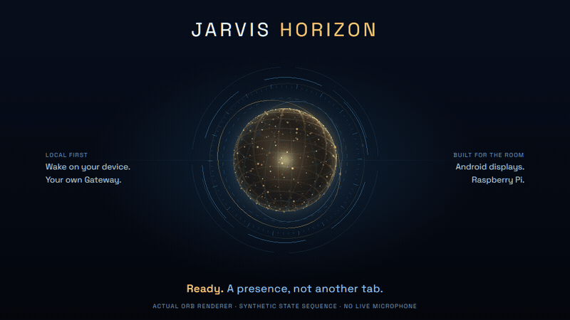
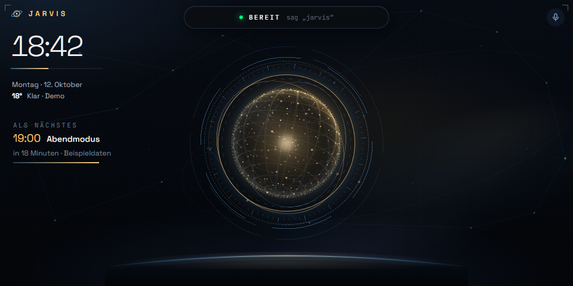
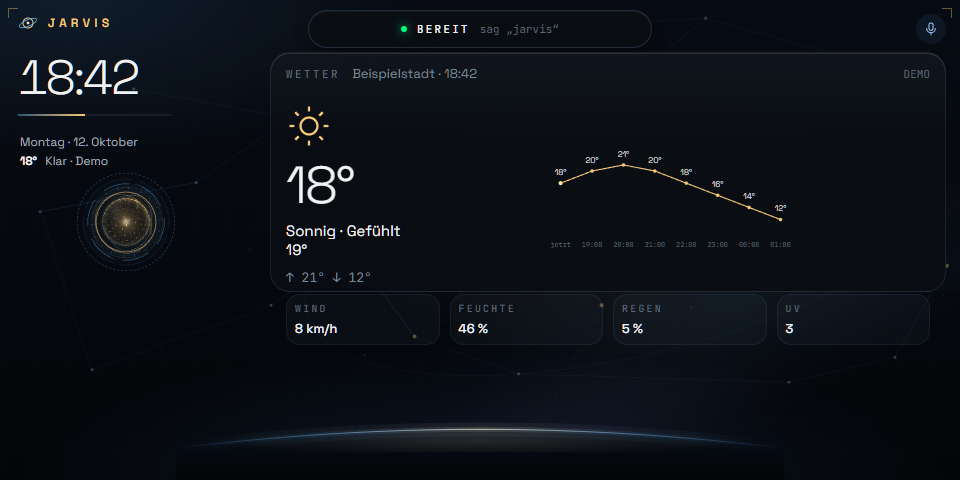
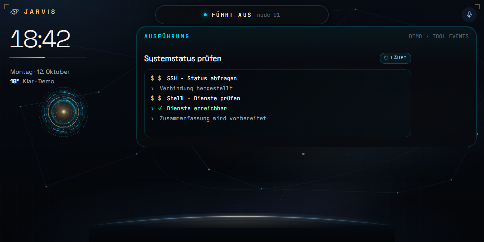
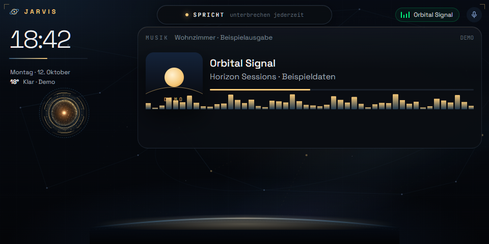
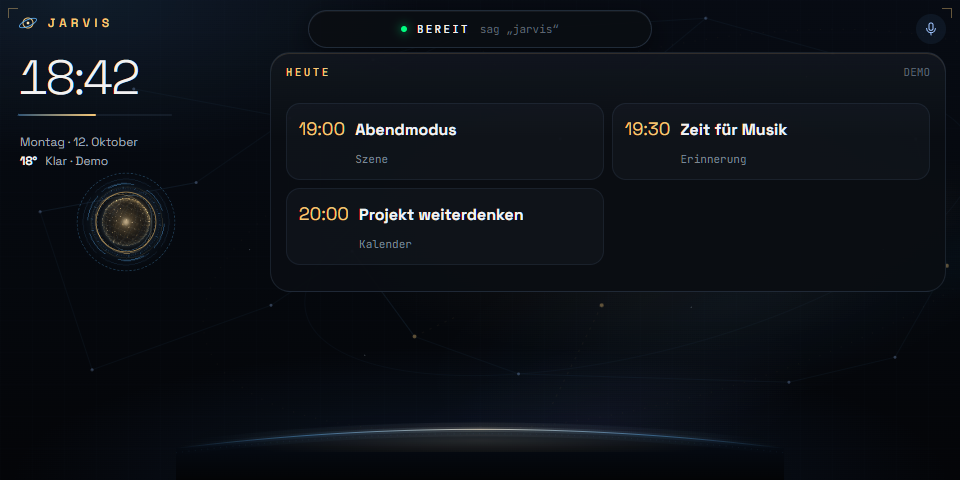
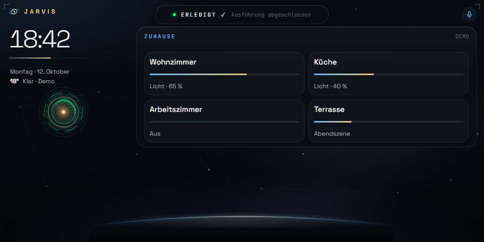
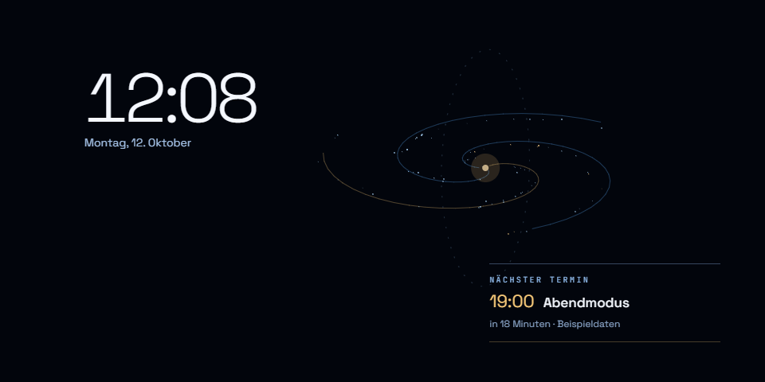
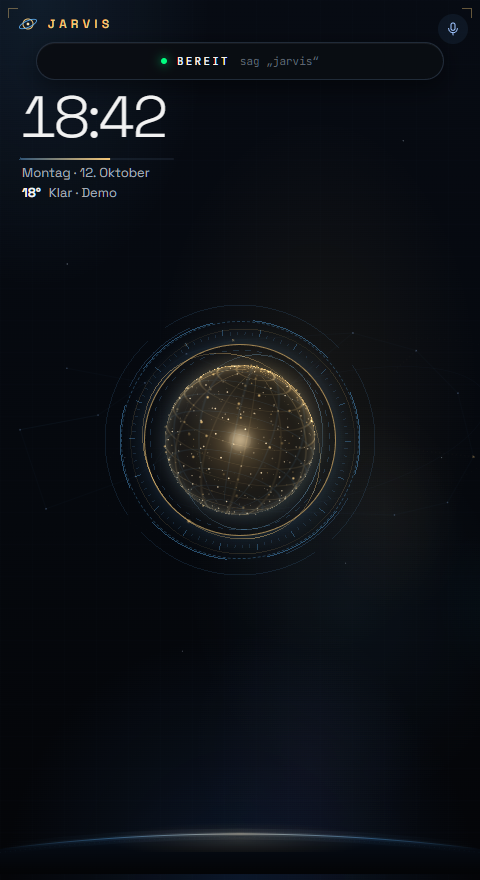
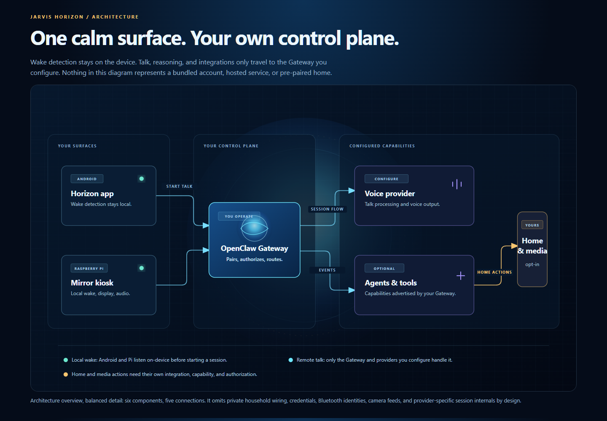

<strong>English</strong> · <a href="README.de.md">Deutsch</a>

# Jarvis Horizon

**A voice-first home surface for the OpenClaw Gateway you already operate.**

Jarvis Horizon turns an Android display or Raspberry Pi into a calm, hands-free presence for your assistant: local wake-word listening, conversation states, live agent activity, camera views, media context and an ambient screen for the moments in between.

*The live orbital animation uses synthetic sample data. Select it to view the MP4 version.*

[Installation](docs/INSTALL.md) · [Compatibility](docs/COMPATIBILITY.md) · [Architecture](docs/ARCHITECTURE.md) · [Validation](docs/VALIDATION.md) · [Contributing](CONTRIBUTING.md)

## A display that shows the moment, not just a chat

Jarvis Horizon is designed for displays that stay in the room. It keeps the current moment legible at a distance, then changes state when your assistant is listening, working, answering or presenting a camera view.

| What the surface does | What makes it useful |
| --- | --- |
| **Listen locally** | A local wake-word path can open a Talk session without leaving a permanent full-screen transcript in the room. Push-to-talk remains available when room acoustics are difficult. |
| **Make work visible** | Received agent, tool and delegated-task events become short, bounded activity labels instead of raw commands, arguments or private output. |
| **Use the screen deliberately** | The Horizon layout adapts to portrait and landscape. Context views can show information supplied by your backend, while the ambient view reduces static exposure during idle time. |
| **Bring in live context** | Android can present camera overlays and full-screen playback. Whether a particular stream includes audio depends on its source, codec and permissions. |
| **Keep control at home** | You provide the Gateway, provider, identity and integrations. No account, token, device identity, household configuration or OTA endpoint is included in this repository. |

## The Horizon language, across surfaces

<table>
  <tr>
    <td width="50%" valign="top"> <strong>Home at a glance.</strong> The room-facing overview keeps time, status and current context in one place.</td>
    <td width="50%" valign="top"> <strong>Weather in context.</strong> A supplied weather view can take the visual lead when it is relevant.</td>
  </tr>
  <tr>
    <td valign="top"> <strong>Visible work.</strong> Received activity becomes a bounded status, not an exposed command stream.</td>
    <td valign="top"> <strong>Media context.</strong> Playback can remain present while the screen stays focused on the room.</td>
  </tr>
  <tr>
    <td valign="top"> <strong>What is next.</strong> Calendar information appears only when your backend provides it.</td>
    <td valign="top"> <strong>Home, on your terms.</strong> Home controls reflect the integrations and capabilities your Gateway advertises.</td>
  </tr>
  <tr>
    <td valign="top"> <strong>Ambient, not absent.</strong> The idle surface shifts content and avoids a permanently static composition.</td>
    <td valign="top"> <strong>Portrait-ready.</strong> The visual system makes room for narrow wall displays and tablets.</td>
  </tr>
</table>

*All screenshots are actual frontend renders with synthetic sample data. They illustrate layouts and states, not a connected Gateway, a live home, or a device-performance result.*

## Your assistant remains the authority

Wake-word detection is local to the surface. After activation, conversation audio follows the Gateway and voice-provider path that **you** configure. Local wake-word detection does not make cloud conversation processing local.

Camera aliases, calendars, media routes, announcements and home actions are optional integrations. A paired Bluetooth speaker is not automatically a microphone, and a requested camera is not automatically a confirmed live stream.

## Release status

Jarvis Horizon is preparing its first public alpha. A signed Android release candidate has been built locally, but public publication remains gated on a fresh portable-artifact audit, a clean Linux validation run and a fresh-device launch check. Until those checks are complete, there is no supported download and no claim of a verified public installation.

When the alpha is published, the supported manual-update path will be the matching [GitHub release](https://github.com/The-Geek-Freaks/jarvis-horizon/releases/tag/v0.1.0-alpha.1). Android OTA is intentionally not configured in the public distribution. See [Validation](docs/VALIDATION.md) for the exact evidence boundary.

The implemented backend is **OpenClaw**. A **Hermes adapter is not included**; it needs a dedicated protocol adapter and end-to-end acceptance coverage before it can be described as supported.

## Choose a surface

| Surface | Intended role | Known boundary |
| --- | --- | --- |
| Android phone or tablet | Wall display or portable terminal | API 27+ with a supported ARM ABI; other devices need their own acceptance run |
| Archos Hello 7 | Portrait or landscape display | Private Android 8.1 / ARM64 deployment evidence only |
| Echo Show 5, second generation | Compact home display | Private evidence is from an already-modified Android 11 device; stock Echo firmware is not an APK target |
| Raspberry Pi 4 | Display or mirror kiosk | DietPi/Debian ARM64 installer and locked runtime payload; physical audio, display and pairing remain installation-specific |

## Start from a clean, owned setup

Read the [installation guide](docs/INSTALL.md) before connecting a display. You need an OpenClaw Gateway you operate, an accepted pairing path and a configured realtime provider for Talk. Never copy another installation's tokens, paired-device identity, recordings, Bluetooth identity, camera URL or OTA configuration.

The default Android tab is Jarvis. For agent-driven views, install the optional [OpenClaw skill](integrations/openclaw/SKILL.md) in your own agent workspace; it checks the device's current effective capabilities before asking the screen to act.

## Help make the first alpha useful

Reports on wake recovery, audio routing, camera decoding and older hardware are valuable when they are reproducible. Include the device, OS/API level, ABI, release, Gateway version and exact steps. Remove personal details from logs; do not upload room recordings, camera footage, tokens or household configuration.

Read [CONTRIBUTING.md](CONTRIBUTING.md). Visible states must come from real runtime events, and performance improvements need measurements.

## Credits

Built on [OpenClaw](https://github.com/openclaw/openclaw), with speech components from [sherpa-onnx](https://github.com/k2-fsa/sherpa-onnx) and [Silero VAD](https://github.com/snakers4/silero-vad). The Pi runtime uses the Debian/DietPi ecosystem, Chromium and the Linux audio stack.

An independent community project by **The Geek Freaks**. Upstream copyrights and licenses are retained. See [LICENSE](LICENSE) and [THIRD_PARTY_NOTICES.md](THIRD_PARTY_NOTICES.md).
