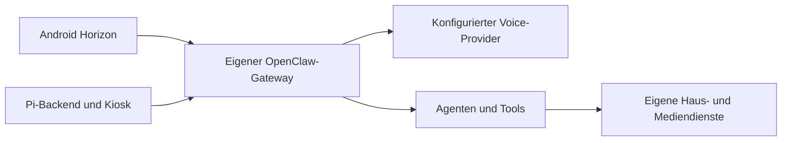

# Architektur

**[English](ARCHITECTURE.md) · [Deutsch](ARCHITECTURE.de.md)**

Jarvis Horizon verbindet Android-Displays und einen Raspberry-Pi-Kiosk mit deinem eigenen OpenClaw-Gateway.

Die Wakeword-Erkennung läuft lokal. Gesprächsaudio wird nach Aktivierung über den konfigurierten Voice-Pfad verarbeitet. Lokale Erkennung bedeutet daher nicht, dass auch die gesamte Unterhaltung lokal bleibt.

## Android

Der Vorbereitungsprozess bezieht einen festen OpenClaw-Quellstand, ergänzt den öffentlichen Overlay und prüft die native Sherpa-Bibliothek. Die öffentliche Paket-ID ist von privaten Installationen getrennt. Der Quellcode enthält die Node-Kommandos `jarvis.display`, `jarvis.ui`, `jarvis.media` und `jarvis.schedule`; der Agent muss die tatsächlich angebotenen Fähigkeiten des verbundenen Geräts prüfen.

Die Anzeige unterscheidet Wakeword-Bereitschaft, laufende Audioaufnahme, zur Verarbeitung angenommenes Audio und Wiedergabe. Besonders bei Geräten ohne wirksame Echounterdrückung sind diese Zustände nicht identisch.

## Raspberry Pi

Die Installation legt versionierte Software unter `/opt/jarvis-mirror/releases` ab und schaltet den Verweis `current` um. Konfiguration liegt unter `/etc/jarvis-mirror`, die lokale Geräteidentität unter `/var/lib/jarvis-mirror`. Chromium, das lokale Python-Backend und der Linux-Audio-Stack übernehmen Darstellung, Aufnahme und Wiedergabe.

Die mitgelieferten Wake-/VAD-Modelle werden nach `/opt/jarvis-mirror/models/wake` installiert. Netzwerk, Mikrofon, Displayausrichtung, Home Assistant und Bluetooth-Ziel bleiben lokal konfigurierbar.

## Agent-Anbindung und Routinen

Die [OpenClaw-Integration](../integrations/openclaw/SKILL.md) enthält einen lokalen Werkzeugaufruf und einen optionalen Cache typisierter Routinen. Sie ersetzt keinen Gateway und ergänzt keine Fähigkeiten auf fremden Geräten. Ein Auftrag darf nur eine aktuell angebotene Gerätefunktion aufrufen.

Die Routine speichert vor einer Aktion eine Ausführungskennung. Bei unklarem Ausgang wird derselbe Auftrag nicht blind wiederholt. Dieser Cache ist Ausführungszustand und baut das Gedächtnissystem deines Agenten nicht um.

## Grenzen

Hauskarten, Kamerastreams, Kalender, Raum-/Musikrouten und Ankündigungen benötigen passende eigene Integrationen. Die öffentliche Android-Ausgabe benutzt manuelle Updates. Pi-OTA ist optional und benötigt einen eigenen Feed und Vertrauensschlüssel. Ein Hermes-Adapter ist nicht enthalten.

Annahme durch ein Tool, Start der Ausführung und tatsächlich sichtbare oder hörbare Wirkung sind getrennte Nachweise. Die Oberfläche und der Agent dürfen einen angeforderten Kamerastream nicht schon als sichtbares Livebild bestätigen.
